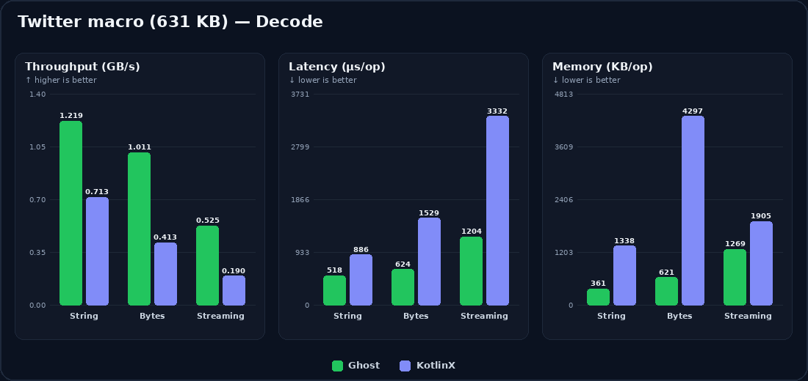

# 👻 Ghost Serializer

**The fastest JSON path for Kotlin Multiplatform: up to 2.7× faster than other serializers, with up to 86% less memory, and proven against the industry's conformance suite.**

- **Built for speed.** Compile-time generated serializers, SWAR parsing and zero-allocation hot paths: 1.07 GB/s decoding bytes and 1.2 GB/s decoding strings on a real 631 KB payload, and faster than the alternatives on every channel we measure.
- **Proven, not promised.** All 318 cases of [JSONTestSuite](https://github.com/nst/JSONTestSuite), the industry-standard JSON parser conformance suite, pass on the string, bytes and streaming channels. Coverage-guided fuzzing has executed more than **765 million** cases against the readers and writers with **0 crashes**.
- **Resilient by design.** When the backend ships messy JSON, Ghost can keep parsing where you opt in, and tells you exactly where it went wrong.

Keep the stack you have: kotlinx.serialization, Moshi, Gson or Jackson, with Ktor, Retrofit or Spring. Add one annotation to the DTOs that carry your traffic and Ghost takes over exactly that path. It is not a rewrite. It is an upgrade where it counts.

[](https://github.com/juanchurtado1991/ghost-serializer/actions/workflows/ci.yml)
[](https://central.sonatype.com/search?q=g:com.ghostserializer)
[](https://kotlinlang.org)
[](docs/wiki/usage-android.md)
[](docs/wiki/usage-kmp.md)
[](docs/wiki/usage-spring-boot.md)
[](https://github.com/juanchurtado1991/ghost-serializer/actions/workflows/ci.yml)

**[Quick Start: first DTO in minutes →](docs/wiki/quick-start.md)** ·
**[Try it in the browser →](https://juanchurtado1991.github.io/ghost-serializer/)** ·
[Maven Central](https://central.sonatype.com/search?q=g:com.ghostserializer) ·
[Roadmap](docs/wiki/roadmap.md)

---

## Performance

Up to **2.7× faster** and **86% leaner** than kotlinx.serialization and Moshi on every channel we measure, and the gain grows with payload size. Adopt it one DTO at a time or across your whole model layer.

Twitter macro (**631 KB**) decode:



| | Ghost | KSER | Moshi |
|:---|---:|---:|---:|
| String | **1.2 GB/s** · 308 KB | 0.72 GB/s · 1338 KB | 0.37 GB/s · 1709 KB |
| Bytes | **1.07 GB/s** · 621 KB | 0.42 GB/s · 4297 KB | 0.28 GB/s · 4668 KB |
| Streaming | **0.53 GB/s** · 1269 KB | 0.19 GB/s · 1905 KB | 0.43 GB/s · 1709 KB |

[Benchmarks](docs/wiki/benchmarks.md) · [HTTP Arena](https://www.http-arena.com/#sort=rps:-1&q=kotlin) · [Playground Speed Test](https://juanchurtado1991.github.io/ghost-serializer/)

---

## Quick start

Add `@GhostSerialization` to a model. Keep `@Serializable` if you already use KotlinX: its call sites keep working.

```kotlin
@Serializable                 // keep: KotlinX call sites still work
@GhostSerialization           // add: Ghost codegen for this class only
data class User(
    @SerialName("user_id")    // keep: Ghost uses this as the wire name
    val id: Long,
    val name: String,
)

Ghost.deserialize<User>(responseBytes)
```

Drop-in for **Ktor**, **Retrofit** and **Spring**, with the same stack you have today. It also keeps parsing when the backend ships messy JSON (`@GhostResilient`, `@GhostFallback`, `RawJson`) and its errors include the JSONPath of the failure.

**Also:** Android · iOS · JVM · Wasm (iOS/Wasm with no registration code, via the Gradle plugin) · YAML · Proto3 JSON · Kotlin **2.2.21+** / KSP **2.3.x** / Ktor **3.3.x+** → [Modules](docs/wiki/modules.md)

---

## Tested against the spec, not just against itself

- **JSON conformance**: all **318** cases of [JSONTestSuite](https://github.com/nst/JSONTestSuite) behave correctly on the string, bytes and streaming channels, in lenient and in strict mode.
- **Fuzzing**: more than **765 million** coverage-guided executions ([Jazzer](https://github.com/CodeIntelligenceTesting/jazzer)) across the readers and writers, **0 crashes**.
- **Differential testing**: the channels are checked against each other and against kotlinx.serialization on every build, and every night with a fresh seed; 8,934 real-world JSON files decode to the same tree as kotlinx.serialization.
- **YAML**: **96.06%** of [yaml-test-suite](https://github.com/yaml/yaml-test-suite) decodes exactly right (268/279) and the writer round-trips **100%**.

Details and how to run each check → [Quality and conformance](docs/wiki/quality.md)

---

## Docs

[Quick Start](docs/wiki/quick-start.md) ·
[Installation](docs/wiki/installation.md) ·
[Android](docs/wiki/usage-android.md) ·
[KMP / Ktor](docs/wiki/usage-kmp.md) ·
[iOS](docs/wiki/usage-ios.md) ·
[Spring](docs/wiki/usage-spring-boot.md) ·
[YAML](docs/wiki/usage-yaml.md) ·
[Proto3 JSON](docs/wiki/usage-protobuf.md) ·
[Advanced](docs/wiki/advanced-features.md) ·
[Quality](docs/wiki/quality.md) ·
[Architecture](docs/wiki/architecture.md) ·
[Contributing](docs/wiki/contributing.md) ·
[Support & Versioning](SUPPORT.md)

## License

[Apache 2.0](LICENSE)
